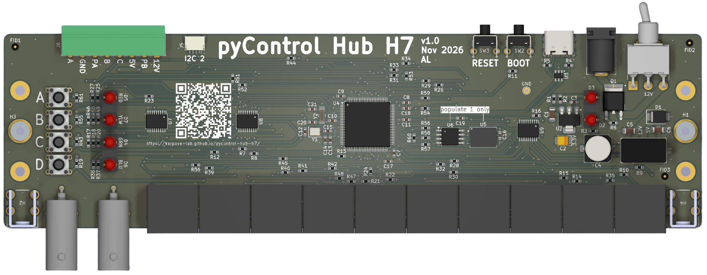
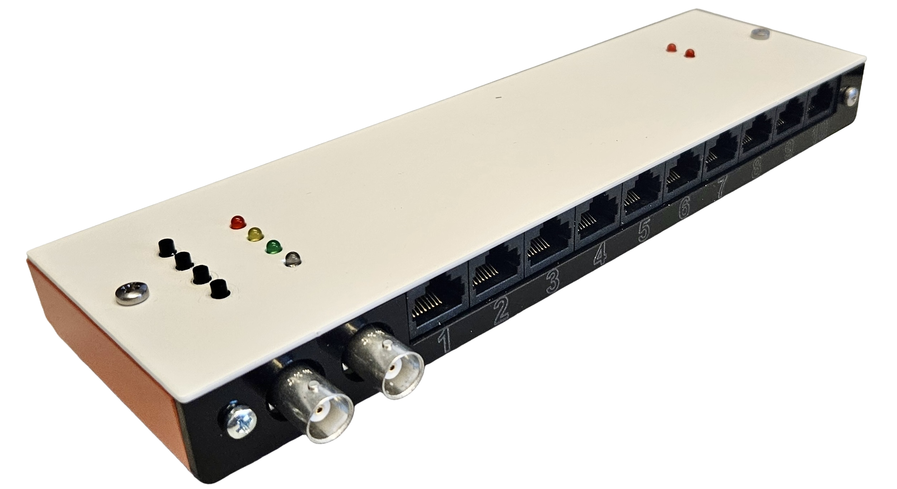
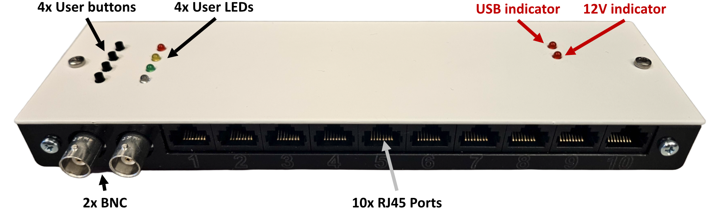
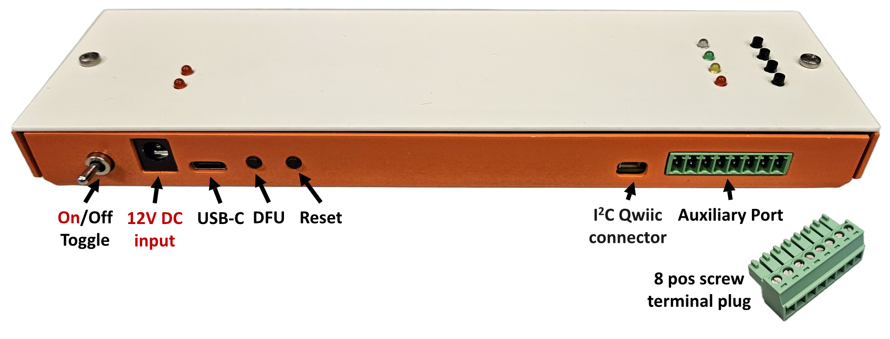
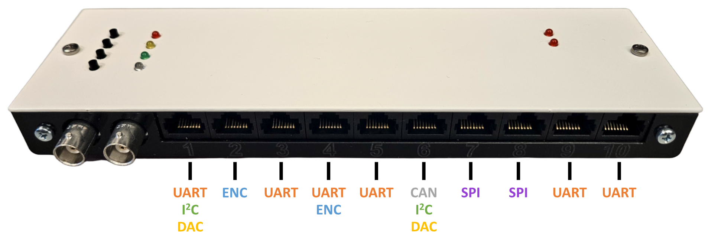
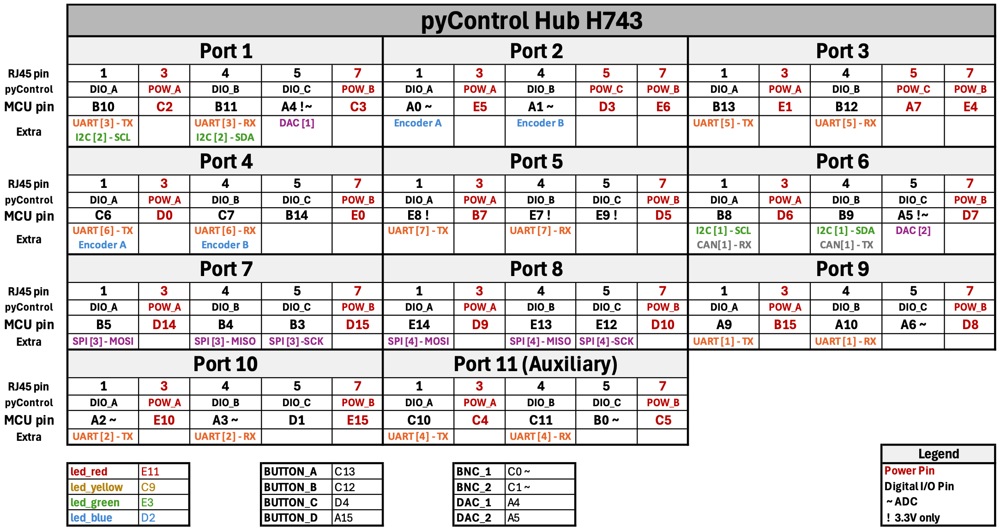

- [Documentation](https://karpova-lab.github.io/pycontrol-hub-h7/)
- [Development discussion](https://github.com/orgs/pyControl/discussions/171)

# pyControl Hub H7

A high-performance hardware hub for [pyControl](https://pycontrol.readthedocs.io/en/latest/), built around an [STM32H743VIT6](https://www.digikey.com/short/4cmvhp93) microcontroller. It interfaces with pyControl [devices](https://pycontrol.readthedocs.io/en/latest/user-guide/hardware/#devices) to record inputs and control outputs for behavioral experiments.





## Features

- 480 MHz Cortex-M7, 1 MB RAM, 2 MB external QSPI flash
- 11 pyControl behavior ports
  - 10 RJ45 connectors
  - 1 auxiliary [8-position terminal block](https://www.digikey.com/short/fpqf2rj0) that pairs with a [screw terminal plug](https://www.digikey.com/short/n57m4m7h)
- 2 BNC connectors
- 1 I²C connector compatible with [Qwiic](https://www.sparkfun.com/qwiic) / [STEMMA QT](https://learn.adafruit.com/introducing-adafruit-stemma-qt/what-is-stemma-qt) / [Qw/ST](https://shop.pimoroni.com/en-us/collections/breakouts?tags=Qw/ST) / [Modulino](https://store.arduino.cc/collections/modulino)
- USB Type-C connector with ESD protection
- DC barrel jack input with reverse polarity protection
- On/off toggle switch, 4 user buttons, reset button, and a DFU button for bootloader access
- Power and USB indicator LEDs, plus 4 user-controllable LEDs (red, yellow, green, blue)
- [Metal enclosure](https://karpova-lab.github.io/pycontrol-hub-h7/building/#case)
- Mounting holes compatible with [DIN rail adapters](https://www.digikey.com/short/h7977mfv) for securing to a [DIN rail](https://www.digikey.com/en/products/filter/hardware-fasteners-accessories/580?s=N4IgjCBcpgHAzFUBjKAzAhgGwM4FMAaEAeygG0QAWMeWSgThAF0iAHAFyhAGV2AnAJYA7AOYgAvkQC0AJiQhUkfgFdCJciACszcZJBzIFACIBJAHIACPhgFYQRU5eu2dQA). Alternatively, the case can sit on [rubber feet](https://www.mcmaster.com/9377k311/).

See the [board comparison](https://karpova-lab.github.io/pycontrol-hub-h7/#pycontrol-board-comparison) for how it stacks up against the pyControl Breakout 1.2.

## Photos





## Peripherals and pin mapping





## Schematic


## Repository layout

| Path | Contents |
|------|----------|
| [`ecad/`](ecad) | KiCad schematic and PCB, BOMs, and Gerbers |
| [`mcad/`](mcad) | Enclosure (laser-cut panels, STEP models) and 3D-printed standoffs |
| [`zensical/`](zensical) | Documentation source |
| [`docs/`](docs) | Built documentation site, served by GitHub Pages |

The KiCad libraries in `ecad/libs` are a git submodule, so clone recursively:

```sh
git clone --recursive https://github.com/Karpova-Lab/pycontrol-hub-h7.git
```

## License

- Hardware designs: [Janelia Open-Source Hardware license](LICENSE_HW.txt)
- Software: [BSD 3-Clause license](LICENSE_SW.txt)
