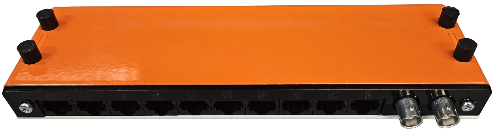
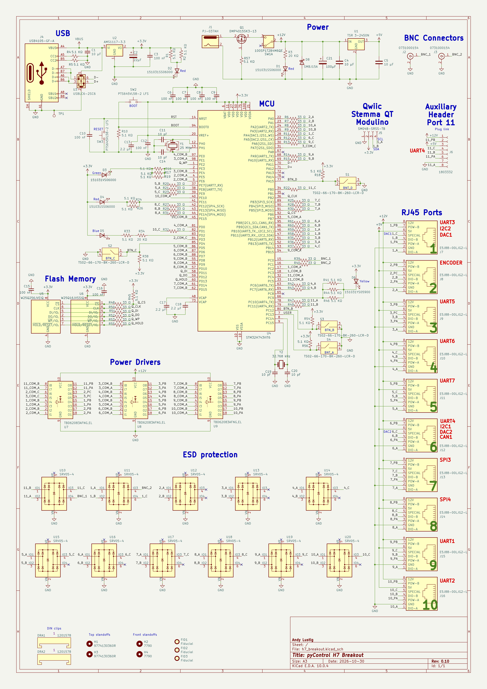
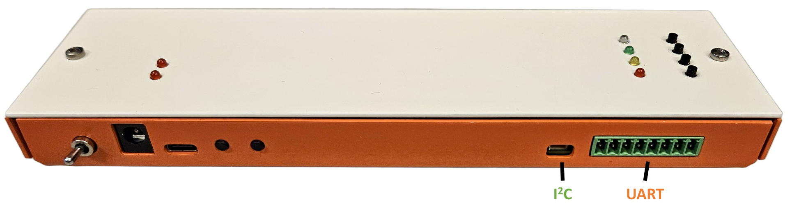

View documentation at https://karpova-lab.github.io/pycontrol-hub-h7/

Original discussion found at https://github.com/orgs/pyControl/discussions/171

# pyControl Hub H7
A pyControl breakout board using an [STM32H743VIT6](https://www.digikey.com/short/7n8h83wr) microcontroller.

- 480 MHz Cortex-M7, 800 KB SRAM, 2 MB external QSPI flash
- 10 pyControl RJ45 behavior ports
- 8 position [terminal block](https://www.digikey.com/short/fpqf2rj0) that pairs with a [screw terminal plug](https://www.digikey.com/short/n57m4m7h)
- 2 BNC connectors
- 1 [QWIIC](https://www.sparkfun.com/qwiic) / [Stemma-QT](https://learn.adafruit.com/introducing-adafruit-stemma-qt/what-is-stemma-qt) / [Modulino](https://store.arduino.cc/collections/modulino) connector
- USB type C connector with ESD protection
- DC barrel jack input with reverse polarity protection
- On/off toggle switch, 4 user buttons, reset button, and a DFU button for bootloader access
- Power and USB indicator LEDs, 4 user controllable LEDs (red, yellow, green and blue)
- Metal enclosure 
- Mounting hole spacing compatible with [DIN adapters](https://www.digikey.com/short/h7977mfv) that securely mount onto [DIN rail](https://www.digikey.com/en/products/filter/hardware-fasteners-accessories/580?s=N4IgjCBcpgHAzFUBjKAzAhgGwM4FMAaEAeygG0QAWMeWSgThAF0iAHAFyhAGV2AnAJYA7AOYgAvkQC0AJiQhUkfgFdCJciACszcZJBzIFACIBJAHIACPhgFYQRU5eu2dQA). Alternatively can secure to [rubber feet](https://elifesciences.org/articles/67846#s4).









## Building the documentation
The documentation source is in [`zensical/`](zensical) and is built with [Zensical](https://zensical.org) into [`docs/`](docs), which is served by GitHub Pages.


To edit/build the docs yourself:

- Install [uv](https://docs.astral.sh/uv/getting-started/installation/):

- From the project root run
```sh
uv run python scripts/docs.py serve
```

uv installs the pinned Python version and dependencies automatically the first time you run the command
