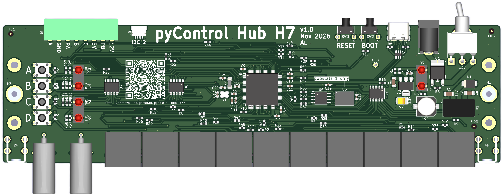
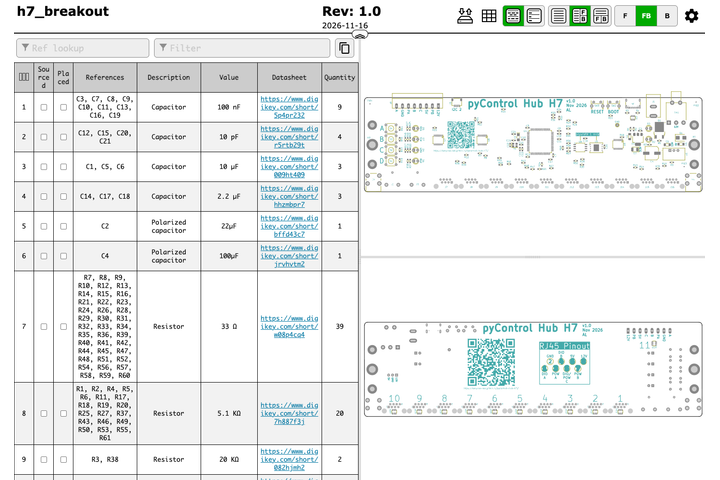
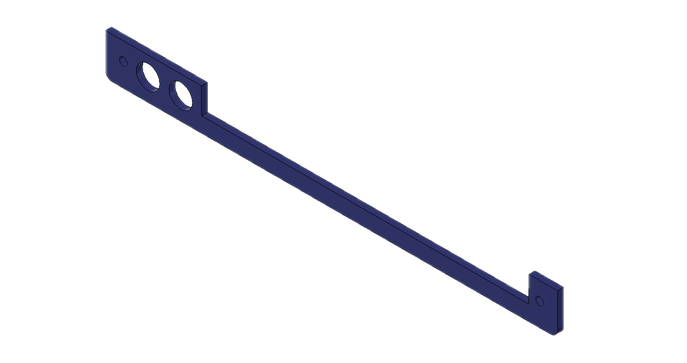
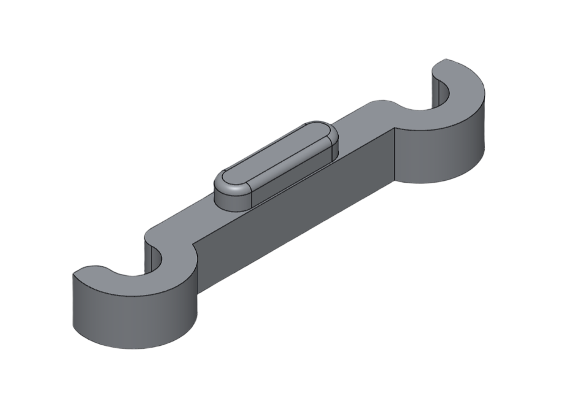

# Building

  <model-viewer
    id="h7-board-model"
    src="building/v10-assembled.glb"
    alt="pyControl Hub H7 PCB assembly and enclosure with removable panels"
    camera-controls
    touch-action="pan-y"
    camera-orbit="35deg 55deg 85%"
    animation-name="Explode"
    animation-crossfade-duration="0"
    field-of-view="30deg"
    shadow-intensity="0.5"
    shadow-softness="1"
    exposure="1"
    style="display:block; width:100%; height:520px; background:#fff; border-radius:12px;">
  </model-viewer>
  
Loading 3D model…

  

    <label for="h7-explode">Exploded view</label>
    <input id="h7-explode" data-explode type="range" min="0" max="100" value="0" step="1" aria-controls="h7-board-model" aria-valuetext="Assembled" style="flex:1; min-width:120px; accent-color:var(--md-accent-fg-color);" disabled>
    <output for="h7-explode" data-explode-value style="min-width:3ch; text-align:right;">0%</output>
  

  

    <button type="button" class="md-button md-button--primary" data-assembly-toggle="front" aria-controls="h7-board-model" aria-pressed="true" disabled><svg aria-hidden="true" focusable="false" viewBox="0 0 24 24" width="20" height="20" fill="none" stroke="currentColor" stroke-width="1.8" stroke-linecap="round" stroke-linejoin="round"><path d="M2 12s3.5-7 10-7 10 7 10 7-3.5 7-10 7S2 12 2 12Z"></path><circle cx="12" cy="12" r="3"></circle><path data-visibility-slash d="M3 3 21 21" display="none"></path></svg>Front panel</button>
    <button type="button" class="md-button md-button--primary" data-assembly-toggle="lid" aria-controls="h7-board-model" aria-pressed="true" disabled><svg aria-hidden="true" focusable="false" viewBox="0 0 24 24" width="20" height="20" fill="none" stroke="currentColor" stroke-width="1.8" stroke-linecap="round" stroke-linejoin="round"><path d="M2 12s3.5-7 10-7 10 7 10 7-3.5 7-10 7S2 12 2 12Z"></path><circle cx="12" cy="12" r="3"></circle><path data-visibility-slash d="M3 3 21 21" display="none"></path></svg>Top lid</button>
    <button type="button" class="md-button md-button--primary" data-assembly-toggle="pcb" aria-controls="h7-board-model" aria-pressed="true" disabled><svg aria-hidden="true" focusable="false" viewBox="0 0 24 24" width="20" height="20" fill="none" stroke="currentColor" stroke-width="1.8" stroke-linecap="round" stroke-linejoin="round"><path d="M2 12s3.5-7 10-7 10 7 10 7-3.5 7-10 7S2 12 2 12Z"></path><circle cx="12" cy="12" r="3"></circle><path data-visibility-slash d="M3 3 21 21" display="none"></path></svg>PCB assembly</button>
    <button type="button" class="md-button md-button--primary" data-assembly-toggle="bottom" aria-controls="h7-board-model" aria-pressed="true" disabled><svg aria-hidden="true" focusable="false" viewBox="0 0 24 24" width="20" height="20" fill="none" stroke="currentColor" stroke-width="1.8" stroke-linecap="round" stroke-linejoin="round"><path d="M2 12s3.5-7 10-7 10 7 10 7-3.5 7-10 7S2 12 2 12Z"></path><circle cx="12" cy="12" r="3"></circle><path data-visibility-slash d="M3 3 21 21" display="none"></path></svg>Bottom case</button>
    <button type="button" class="md-button md-button--primary" data-assembly-toggle="spacers" aria-controls="h7-board-model" aria-pressed="true" disabled><svg aria-hidden="true" focusable="false" viewBox="0 0 24 24" width="20" height="20" fill="none" stroke="currentColor" stroke-width="1.8" stroke-linecap="round" stroke-linejoin="round"><path d="M2 12s3.5-7 10-7 10 7 10 7-3.5 7-10 7S2 12 2 12Z"></path><circle cx="12" cy="12" r="3"></circle><path data-visibility-slash d="M3 3 21 21" display="none"></path></svg>Board spacers</button>
    <button type="button" class="md-button md-button--primary" data-assembly-toggle="feet" aria-controls="h7-board-model" aria-pressed="true" disabled><svg aria-hidden="true" focusable="false" viewBox="0 0 24 24" width="20" height="20" fill="none" stroke="currentColor" stroke-width="1.8" stroke-linecap="round" stroke-linejoin="round"><path d="M2 12s3.5-7 10-7 10 7 10 7-3.5 7-10 7S2 12 2 12Z"></path><circle cx="12" cy="12" r="3"></circle><path data-visibility-slash d="M3 3 21 21" display="none"></path></svg>Rubber feet</button>
    <button type="button" class="md-button" data-model-reset aria-controls="h7-board-model" hidden disabled><svg aria-hidden="true" focusable="false" viewBox="0 0 24 24" width="20" height="20" fill="none" stroke="currentColor" stroke-width="1.8" stroke-linecap="round" stroke-linejoin="round"><path d="M3 11a9 9 0 1 1 2.6 7.1"></path><path d="M3 3v8h8"></path></svg>Reset</button>
  

## Printed Circuit Board

{ target="_blank" }

-   #### [Schematic](building/pcb/schematic.pdf){ target="_blank" rel="noopener noreferrer" }
    ---
    { target="_blank" rel="noopener noreferrer" }

-   #### [Interactive layout](building/pcb/viewer.html){ target="_blank" rel="noopener noreferrer" }
    ---
    { target="_blank" rel="noopener noreferrer" }

-   #### [Interactive BOM](building/pcb/bom.html){ target="_blank" rel="noopener noreferrer" }
    ---
    { target="_blank" rel="noopener noreferrer" }

!!! warning "Sourcing Parts"
    Both the flash memory and the microcontroller can sometimes be hard to source.

    For the memory, the PCB design includes both **8-WSON (8x6)** and **8-SOIC** footprints to accommodate multiple packages of **Winbond Quad SPI Flash Memory** operating at **3.3V**.
    Here is a [Digi-Key search for parts that match the requirements](https://www.digikey.com/short/2bhr1z4p)

    For the microcontroller, either [STM32H743VIT6TR](https://www.digikey.com/short/dqfq9h4t) or [STM32H743VGT6](https://www.digikey.com/short/84rvf05r) will work with the firmware.

## Case

Parts are designed in [SolidCraft](https://solidcraft.io/), a free and open-source 3D CAD software.

### Laser Cut Parts

-   #### Base
    ---
    

    - Material: 304 Stainless Steel
    - Thickness: 0.060"
    - Three 90° bends
    - Powder coated

    [:material-file-download: DXF file](building/lasercut/base.dxf){ .md-button .md-button--primary }
    [:material-file-download: STEP file](building/lasercut/base.step){ .md-button .md-button--primary }

-   #### Lid
    ---
    

    - Material: 304 Stainless Steel
    - Thickness: 0.048"
    - Powder coated

-   #### Front
    ---
    

    - Material: [Cast Acrylic](https://www.mcmaster.com/8505K741/)
    - Thickness: 0.125"

### 3D Prints

-   #### LED Standoffs
    ---
    

    [:material-file-download: SolidCraft file](building/prints/LED_standoff.sc){ .md-button .md-button--primary }
    [:material-file-download: STEP file](building/prints/LED_standoff.step){ .md-button .md-button--primary }

-   #### Board Standoffs
    ---
    

    [:material-file-download: SolidCraft file](building/prints/board_standoff.sc){ .md-button .md-button--primary }
    [:material-file-download: STEP file](building/prints/board_standoff.step){ .md-button .md-button--primary }

[:material-file-download: Download 3MF file](building/prints/standoffs.3mf){ .md-button .md-button--primary }

!!! success "Verified setup"

    Parts have been tested and confirmed to work using the following setup:

    - Printer: Bambu X1E
    - Nozzle diameter: 0.4 mm
    - Material: [PLA](https://us.store.bambulab.com/collections/bambu-lab-3d-printer-filament/products/pla-basic-filament?variant=40988815556744)
    - Slicer: [OrcaSlicer v2.4.2](https://github.com/OrcaSlicer/OrcaSlicer/releases/tag/v2.4.2)
    - Layer height: 0.12 mm

### Off the shelf hardware
The base can either have rubber feet or DIN rail adapters.

| Qty | Description      | Part Number                                       | Supplier      |
|-----|------------------|---------------------------------------------------|---------------|
| 4   | M3 x 5mm screws for front and top panels | [92000A114](https://www.mcmaster.com/92000A114/)| McMaster-Carr |
| 2   | M3 x 10mm screws for mounting PCB to base | [92000A120](https://www.mcmaster.com/92000A120/)| McMaster-Carr |
| 4   | Rubber Feet      | [9377K311](https://www.mcmaster.com/9377K311/)    | McMaster-Carr |
| 2   | DIN Rail Adapter | [1201578](https://www.digikey.com/short/03j9w8br) | Digi-Key      |
| 1   | DIN Rail         | [search](https://www.digikey.com/short/4vzbnphw)  | Digi-Key      |
