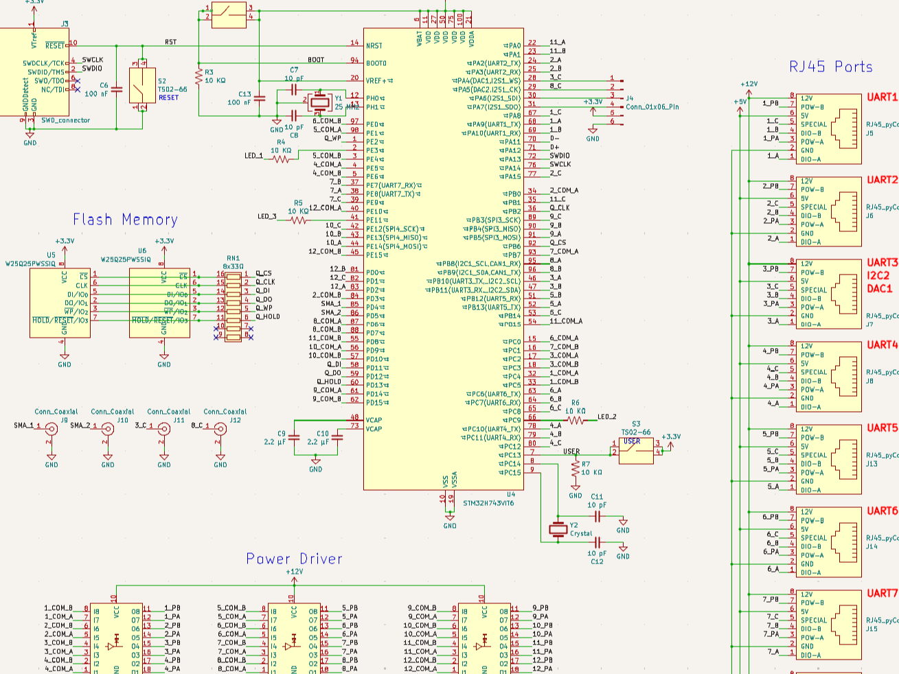
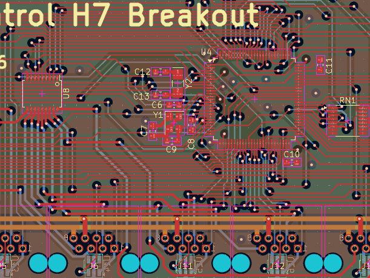
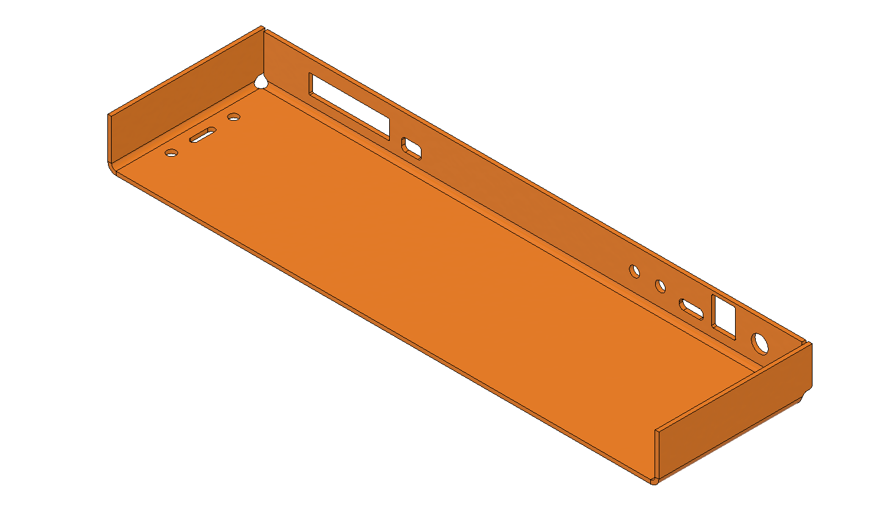
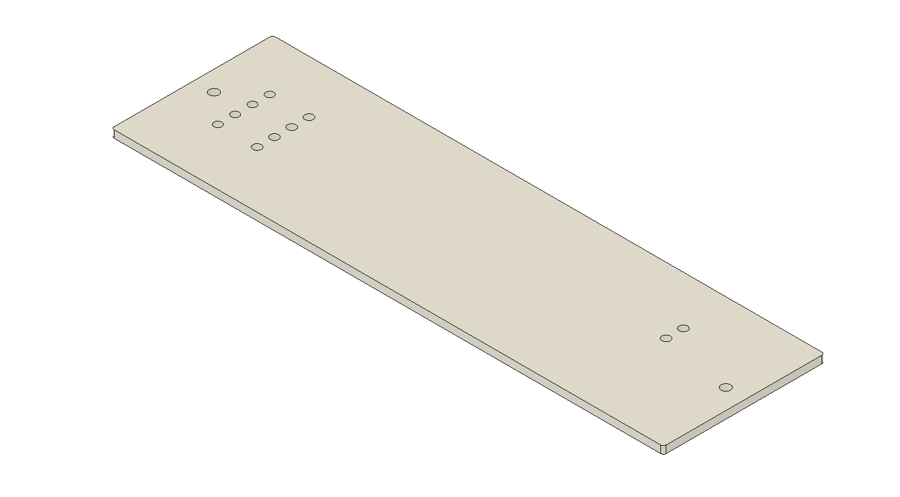
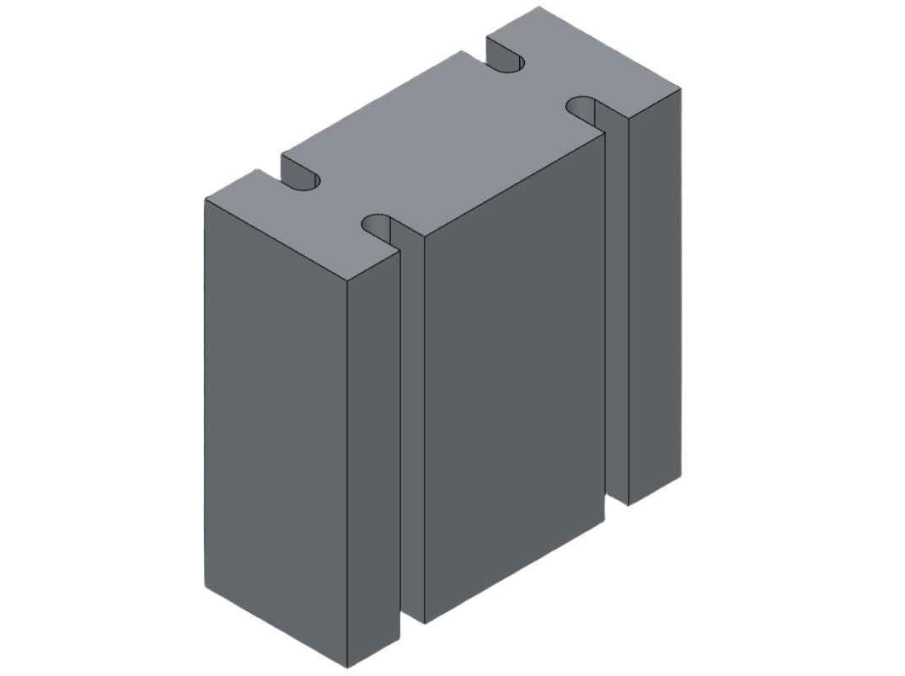
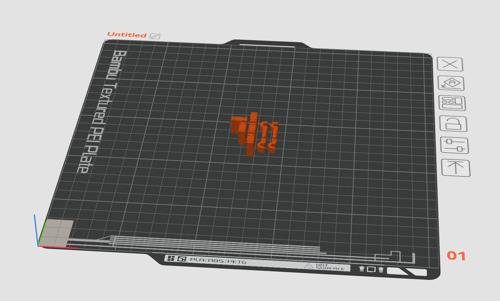

# Building

  <model-viewer
    id="h7-board-model"
    src="building/v10-assembled.glb"
    alt="pyControl Hub H7 PCB assembly and enclosure with removable panels"
    camera-controls
    touch-action="pan-y"
    camera-orbit="35deg 55deg 85%"
    animation-name="Explode"
    animation-crossfade-duration="0"
    field-of-view="30deg"
    shadow-intensity="0.5"
    shadow-softness="1"
    exposure="1"
    style="display:block; width:100%; height:520px; background:#fff; border-radius:12px;">
  </model-viewer>
  
Loading 3D model…

  

    <label for="h7-explode">Exploded view</label>
    <input id="h7-explode" data-explode type="range" min="0" max="100" value="0" step="1" aria-controls="h7-board-model" aria-valuetext="Assembled" style="flex:1; min-width:120px; accent-color:var(--md-accent-fg-color);" disabled>
    <output for="h7-explode" data-explode-value style="min-width:3ch; text-align:right;">0%</output>
  

  

    <button type="button" class="md-button md-button--primary" data-assembly-toggle="front" aria-controls="h7-board-model" aria-pressed="true" disabled><svg aria-hidden="true" focusable="false" viewBox="0 0 24 24" width="20" height="20" fill="none" stroke="currentColor" stroke-width="1.8" stroke-linecap="round" stroke-linejoin="round"><path d="M2 12s3.5-7 10-7 10 7 10 7-3.5 7-10 7S2 12 2 12Z"></path><circle cx="12" cy="12" r="3"></circle><path data-visibility-slash d="M3 3 21 21" display="none"></path></svg>Front panel</button>
    <button type="button" class="md-button md-button--primary" data-assembly-toggle="lid" aria-controls="h7-board-model" aria-pressed="true" disabled><svg aria-hidden="true" focusable="false" viewBox="0 0 24 24" width="20" height="20" fill="none" stroke="currentColor" stroke-width="1.8" stroke-linecap="round" stroke-linejoin="round"><path d="M2 12s3.5-7 10-7 10 7 10 7-3.5 7-10 7S2 12 2 12Z"></path><circle cx="12" cy="12" r="3"></circle><path data-visibility-slash d="M3 3 21 21" display="none"></path></svg>Top lid</button>
    <button type="button" class="md-button md-button--primary" data-assembly-toggle="pcb" aria-controls="h7-board-model" aria-pressed="true" disabled><svg aria-hidden="true" focusable="false" viewBox="0 0 24 24" width="20" height="20" fill="none" stroke="currentColor" stroke-width="1.8" stroke-linecap="round" stroke-linejoin="round"><path d="M2 12s3.5-7 10-7 10 7 10 7-3.5 7-10 7S2 12 2 12Z"></path><circle cx="12" cy="12" r="3"></circle><path data-visibility-slash d="M3 3 21 21" display="none"></path></svg>PCB assembly</button>
    <button type="button" class="md-button md-button--primary" data-assembly-toggle="bottom" aria-controls="h7-board-model" aria-pressed="true" disabled><svg aria-hidden="true" focusable="false" viewBox="0 0 24 24" width="20" height="20" fill="none" stroke="currentColor" stroke-width="1.8" stroke-linecap="round" stroke-linejoin="round"><path d="M2 12s3.5-7 10-7 10 7 10 7-3.5 7-10 7S2 12 2 12Z"></path><circle cx="12" cy="12" r="3"></circle><path data-visibility-slash d="M3 3 21 21" display="none"></path></svg>Bottom case</button>
    <button type="button" class="md-button md-button--primary" data-assembly-toggle="spacers" aria-controls="h7-board-model" aria-pressed="true" disabled><svg aria-hidden="true" focusable="false" viewBox="0 0 24 24" width="20" height="20" fill="none" stroke="currentColor" stroke-width="1.8" stroke-linecap="round" stroke-linejoin="round"><path d="M2 12s3.5-7 10-7 10 7 10 7-3.5 7-10 7S2 12 2 12Z"></path><circle cx="12" cy="12" r="3"></circle><path data-visibility-slash d="M3 3 21 21" display="none"></path></svg>Board spacers</button>
    <button type="button" class="md-button md-button--primary" data-assembly-toggle="feet" aria-controls="h7-board-model" aria-pressed="true" disabled><svg aria-hidden="true" focusable="false" viewBox="0 0 24 24" width="20" height="20" fill="none" stroke="currentColor" stroke-width="1.8" stroke-linecap="round" stroke-linejoin="round"><path d="M2 12s3.5-7 10-7 10 7 10 7-3.5 7-10 7S2 12 2 12Z"></path><circle cx="12" cy="12" r="3"></circle><path data-visibility-slash d="M3 3 21 21" display="none"></path></svg>Rubber feet</button>
    <button type="button" class="md-button" data-model-reset aria-controls="h7-board-model" hidden disabled><svg aria-hidden="true" focusable="false" viewBox="0 0 24 24" width="20" height="20" fill="none" stroke="currentColor" stroke-width="1.8" stroke-linecap="round" stroke-linejoin="round"><path d="M3 11a9 9 0 1 1 2.6 7.1"></path><path d="M3 3v8h8"></path></svg>Reset</button>
  

## Printed Circuit Board

{ target="_blank" }

<!-- !!! tip "Ordering PCBs"
    Order the PCB from [OSH Park](https://oshpark.com/) or [Aisler](https://aisler.net/), or manually upload the gerber files to your preferred PCB manufacturer.

[:material-file-download: Download gerber files](h7_breakout_0_2.zip){ .md-button } 
[:material-cart: Order from OSH Park](){ .md-button } [:material-cart: Order from Aisler](){ .md-button }  -->

-   #### Schematic
    ---
    

-   #### Layout
    ---
    

-   #### Interactive BOM
    ---
    

#### Bill of Materials

| Quantity | Reference                                                                                 | Description             | Value/MPN                                                          |
| -------- | ----------------------------------------------------------------------------------------- | ----------------------- | ------------------------------------------------------------------ |
| 3        | C1, C4, C5                                                                                | Capacitor               | [10 µF](https://www.digikey.com/short/009ht409)                    |
| 1        | C2                                                                                        | Polarized capacitor     | [22µF](https://www.digikey.com/short/bffd43c7)                     |
| 9        | C3, C6-C10, C12, C15, C16                                                                 | Capacitor               | [100 nF](https://www.digikey.com/short/5p4pr232)                   |
| 4        | C11, C14, C19, C20                                                                        | Capacitor               | [10 pF](https://www.digikey.com/short/r5rtb29t)                    |
| 3        | C13, C17, C18                                                                             | Capacitor               | [2.2 µF](https://www.digikey.com/short/hhzmbpr7)                   |
| 1        | C21                                                                                       | Polarized capacitor     | [100µF](https://www.digikey.com/short/jrvhvtm2)                    |
| 3        | D1, D2, D4                                                                                | Red LED                 | [151031SS06000](https://www.digikey.com/short/072zff2q)            |
| 1        | D3                                                                                        | Green LED               | [151031VS06000](https://www.digikey.com/short/vb0zvrd4)            |
| 1        | D5                                                                                        | Blue LED                | [151033BS03000](https://www.digikey.com/short/zw3jz18m)            |
| 1        | D6                                                                                        | Yellow LED              | [151031YS05900](https://www.digikey.com/short/nmrftz94)            |
| 1        | D8                                                                                        | Schottky diode          | [SMBJ15A](https://www.digikey.com/short/8cz3zv3c)                  |
| 2        | DRA1, DRA2                                                                                | DIN rail adapter        | [1201578](https://www.digikey.com/short/dc54tmvm)                  |
| 2        | H1, H3                                                                                    | 13mm threaded standoff  | [9774130360R](https://www.digikey.com/short/wz993m9t)              |
| 2        | H2, H4                                                                                    | RA screw mount          | [7790](https://www.digikey.com/short/n4b5wqj7)                     |
| 1        | J1                                                                                        | DC barrel jack          | [PJ-037AH](https://www.digikey.com/short/bdvdrmh9)                 |
| 2        | J2, J3                                                                                    | BNC connector           | [0731000154](https://www.digikey.com/short/2nj4fch8)               |
| 1        | J4                                                                                        | USB Type C connector    | [USB4105-GF-A](https://www.digikey.com/short/qprqqhnb)             |
| 1        | J5                                                                                        | Qwiic connector         | [SM04B-SRSS-TB](https://www.digikey.com/short/m03n5v7m)            |
| 1        | J6                                                                                        | 8pos Terminal Block     | [1803332](https://www.digikey.com/short/75fdf5t5)                  |
| 10       | J7-J16                                                                                    | RJ45 socket             | [E5J88-00LJG2-L](https://www.digikey.com/short/wvt4z0f9)           |
| 1        | Q1                                                                                        | 40V 3A P-Channel MOSFET | [DMP4015SK3-13](https://www.digikey.com/short/d57vqp75)            |
| 20       | R1, R2, R4, R5, R10, R16-R19, R24, R26, R33, R38, R41, R44-R46, R54, R56, R57             | Resistor                | [5.1 KΩ](https://www.digikey.com/short/7h887f3j)                   |
| 2        | R3, R34                                                                                   | Resistor                | [20 KΩ](https://www.digikey.com/short/082hjmh2)                    |
| 39       | R6-R9, R11-R15, R20-R23, R25, R27-R32, R35-R37, R39, R40, R42, R43, R47-R53, R55, R58-R61 | Resistor                | [33 Ω](https://www.digikey.com/short/w08p4cq4)                     |
| 4        | S1-S4                                                                                     | 12mm tactile switch     | [TS02-66-170-BK-260-LCR-D](https://www.digikey.com/short/5zrnb72h) |
| 1        | SW1                                                                                       | Toggle switch           | [100SP1T2B4M6QE](https://www.digikey.com/short/4rpfjf9f)           |
| 2        | SW2, SW3                                                                                  | RA tactile switch       | [PTS645VL58-2 LFS](https://www.digikey.com/short/bnb210zd)         |
| 1        | U1                                                                                        | DC DC Converter         | [TSR 3-2450N](https://www.digikey.com/short/tn7nv799)              |
| 1        | U2                                                                                        | LDO regulator           | [AMS1117-3.3](https://www.digikey.com/short/22980jpq)              |
| 1        | U3                                                                                        | ESD protection          | [USBLC6-2SC6](https://www.digikey.com/short/jmvr771q)              |
| 1        | U4                                                                                        | Microcontroller         | [STM32H743VIT6](https://www.digikey.com/short/8nncrv0f)            |
| 1        | U5                                                                                        | Quad SPI Flash Memory   | [W25Q256JVEIQ](https://www.digikey.com/short/tn9w3j0r)             |
| 3        | U7-U9                                                                                     | Transistor array        | [TBD62083AFNG,EL](https://www.digikey.com/short/qmnr87cv)          |
| 11       | U10-U20                                                                                   | ESD protection          | [SRV05-4](https://www.digikey.com/short/tt7h290t)                  |
| 1        | Y1                                                                                        | Four pin crystal        | [25 MHz](https://www.digikey.com/short/0rwmh0m7)                   |
| 1        | Y2                                                                                        | Two pin crystal         | [32.768 kHz](https://www.digikey.com/short/pbpt20pn)               |

!!! warning "Flash availability"
    There is a memory shortage right now, so availability can be suspect.
    This PCB design includes both **8-WSON (8x6)** and **8-SOIC** footprints to accommodate multiple packages of **Winbond Quad SPI Flash Memory** operating at **3.3V**.
    Here is a [Digi-Key search for parts that match the requirements](https://www.digikey.com/short/2bhr1z4p)

## Case

Parts are designed in [SolidCraft](https://solidcraft.io/), a free and open-source 3D modeling software.

### Laser Cut Parts

-   #### Base
    ---
    

    - Material: 304 Stainless Steel
    - Thickness: 0.060"
    - Three 90° bends
    - Powder coated

    [:material-file-download: DXF file](building/lasercut/base.dxf){ .md-button .md-button--primary }
    [:material-file-download: STEP file](building/lasercut/base.dxf){ .md-button .md-button--primary }

-   #### Lid
    ---
    

    - Material: 304 Stainless Steel
    - Thickness: 0.048"
    - Powder coated

-   #### Front
    ---
    

    - Material: [Cast Acrylic](https://www.mcmaster.com/8505K741/)
    - Thickness: 0.125"

### 3D Prints

-   #### LED Standoffs
    ---
    

    [:material-file-download: SolidCraft file](building/prints/led_standoff.sc){ .md-button .md-button--primary }
    [:material-file-download: STEP file](building/prints/led_standoff.step){ .md-button .md-button--primary }

-   #### Board Standoffs
    ---
    

    [:material-file-download: SolidCraft file](building/prints/board_standoff.sc){ .md-button .md-button--primary }
    [:material-file-download: STEP file](building/prints/board_standoff.step){ .md-button .md-button--primary }

[:material-file-download: Download 3MF file](building/prints/standoffs.3mf){ .md-button .md-button--primary }

!!! success "Verified setup"

    Parts have been tested and confirmed to work using the following setup:

    - Printer: Bambu X1E
    - Nozzle diameter: 0.4 mm
    - Material: [PLA](https://us.store.bambulab.com/collections/bambu-lab-3d-printer-filament/products/pla-basic-filament?variant=40988815556744)
    - Slicer: [OrcaSlicer v2.4.2](https://github.com/OrcaSlicer/OrcaSlicer/releases/tag/v2.4.2)
    - Layer height: 0.12 mm

### Off the shelf hardware
The base can either have rubber feet or DIN rail adapters.

| Qty | Description      | Part Number                                       | Supplier      |
|-----|------------------|---------------------------------------------------|---------------|
| 4   | M3 x 5mm screws for front and top panels | [92000A114](https://www.mcmaster.com/92000A114/)| McMaster-Carr |
| 2   | M3 x 10mm screws for mounting PCB to base | [92000A120](https://www.mcmaster.com/92000A120/)| McMaster-Carr |
| 4   | Rubber Feet      | [9377K311](https://www.mcmaster.com/9377K311/)    | McMaster-Carr |
| 2   | DIN Rail Adapter | [1201578](https://www.digikey.com/short/03j9w8br) | Digi-Key      |
| 1   | DIN Rail         | [search](https://www.digikey.com/short/4vzbnphw)  | Digi-Key      |
