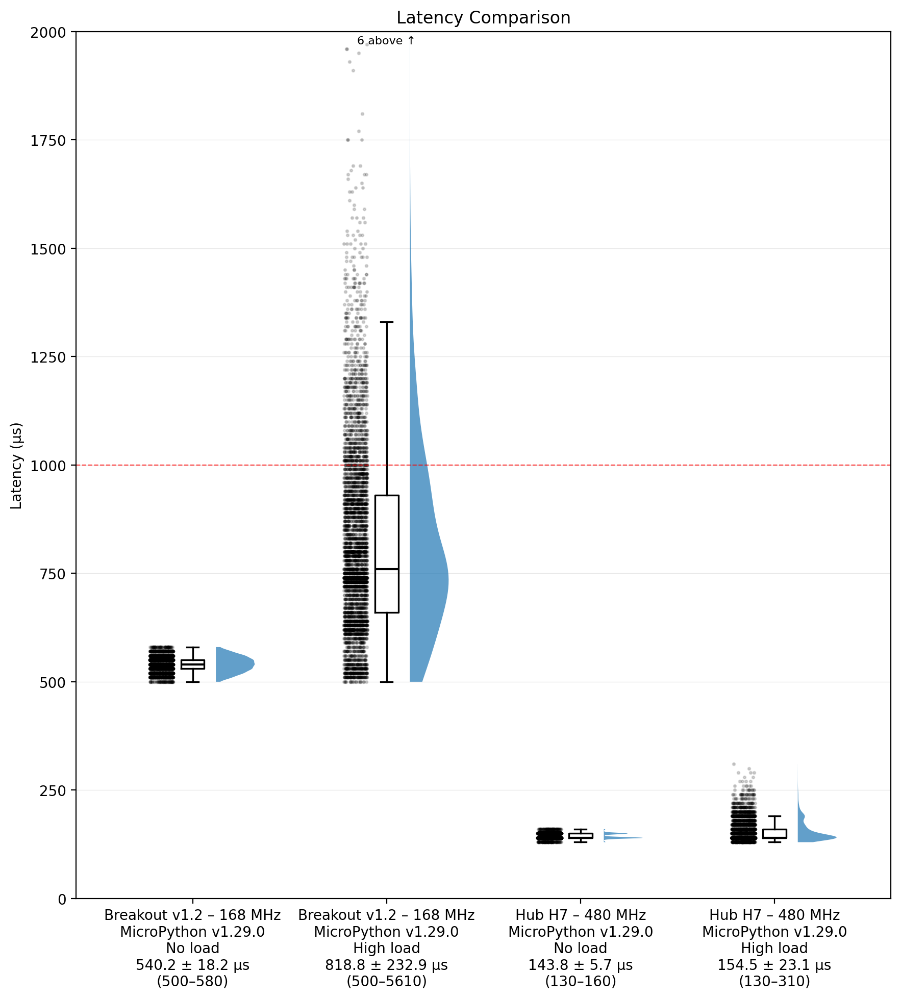

# Overview

This breakout board is a high-performance hardware hub for the [pyControl](https://pycontrol.readthedocs.io/en/latest/) project. 
Driven by the cross-platform open-source GUI software, it is able to interface with a variety of peripheral [devices](https://pycontrol.readthedocs.io/en/latest/user-guide/hardware/#devices) to record inputs and control outputs for behavioral experiments.

{ target="_blank" }
{ target="_blank" }
{ target="_blank" }
{ target="_blank" }
{ target="_blank" }

## pyControl Board Comparison

|                                    | pyControl Breakout 1.2 | pyControl Hub H7 1.0      |
|------------------------------------|------------------------|---------------------------|
| **Dimensions**                     | 1.8 x 7.6 in           | 2.4 x 8.5 in              |
| **Microcontroller**                | [STM32F405RG](https://www.digikey.com/short/3h0hrqrw)    | [STM32H743VIT6](https://www.digikey.com/short/4cmvhp93)    |
| CPU                                | 168 MHz Cortex-M4F     | 480 MHz Cortex-M7         |
| RAM                                | 192 KB                 | 1 MB                      |
| Flash ROM                          | 1 MB                   | 2 MB                      |
| **Connections**                    |                        |                           |
| USB                                | Micro USB-B            | USB Type-C                |
| RJ45 Behavior Ports                | 6                      | 10                        |
| BNC Connectors                     | 4                      | 2                         |
| I^2^C ([Qwiic](https://www.sparkfun.com/qwiic)/[STEMMA QT](https://learn.adafruit.com/introducing-adafruit-stemma-qt/what-is-stemma-qt)/[Modulino](https://store.arduino.cc/collections/modulino))    | -                      | 1                          |
| Auxiliary Connector                | -                      | 8-position terminal [block](https://www.digikey.com/short/75fdf5t5) and [plug](https://www.digikey.com/short/5q11274z)                        |
| **Interfaces**                     |                        |                           |
| User Buttons                       | 1                      | 4                         |
| Indicator LEDs                     | 4-color, 10-LED light bar  | 4-color                   |
| **Input / Output**                 |                        |                           |
| Power Driver Pins                  | 14                     | 24                        |
| Digital I/O Pins                   | 15                     | 33                        |
| DAC pins                           | 2                      | 2                         |
| ADC pins                           | 6                      | 8                         |
| UART buses                         | 3                      | 7                         |
| I^2^C buses                        | 2                      | 2                         |

### Performance

The goal is to keep latency below the 1ms timestamp resolution of the pyControl framework. 
The high load setup is an extreme condition, where the M4 processor on the pyControl Breakout 1.2 began showing some limitations. 
The H7 Breakout 0.9 performs great in all conditions.

The benchmarking method is described in the pyControl manuscript (see "Framework Performance" in the [results section](https://elifesciences.org/articles/67846#s2) and "Framework performance validation" in the [materials and methods section](https://elifesciences.org/articles/67846#s4)).
