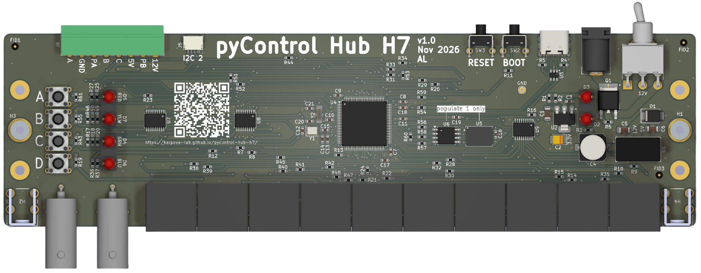
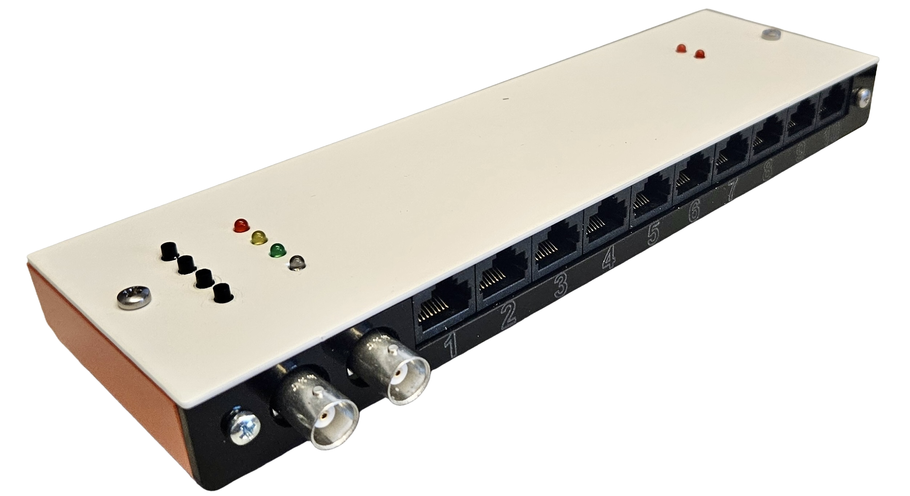
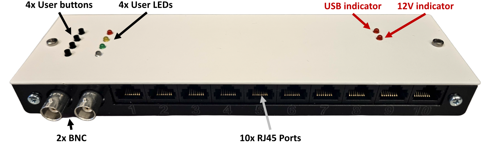
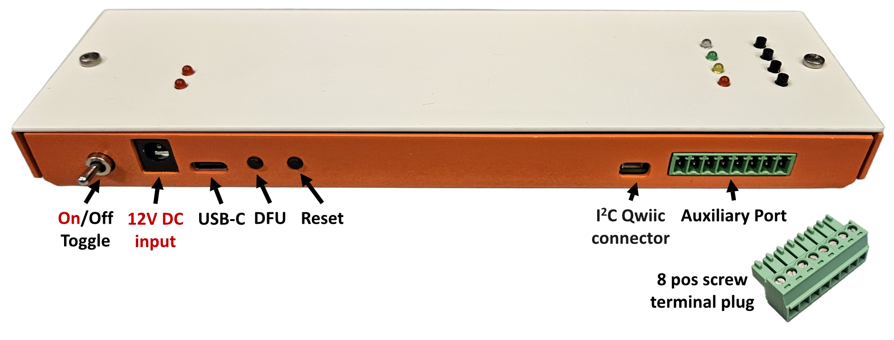
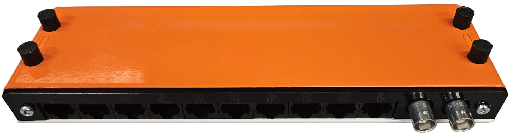

# Overview

This breakout board is a high-performance hardware hub for the [pyControl](https://pycontrol.readthedocs.io/en/latest/) project. 
Driven by the cross-platform open-source GUI software, it is able to interface with a variety of peripheral [devices](https://pycontrol.readthedocs.io/en/latest/user-guide/hardware/#devices) to record inputs and control outputs for behavioral experiments.

{ target="_blank" }
{ target="_blank" }
{ target="_blank" }
{ target="_blank" }
{ target="_blank" }

## pyControl Board Comparison

|                                    | pyControl Breakout 1.2 | pyControl Hub H7 1.0      |
|------------------------------------|------------------------|---------------------------|
| **Dimensions**                     | 1.8 x 7.6 in           | 2.4 x 8.5 in              |
| **Microcontroller**                | [STM32F405RG](https://www.digikey.com/short/3h0hrqrw)    | [STM32H743VIT6](https://www.digikey.com/short/4cmvhp93)    |
| CPU                                | 168 MHz Cortex-M4F     | 480 MHz Cortex-M7         |
| RAM                                | 192 KB                 | 1 MB                      |
| Flash ROM                          | 1 MB                   | 2 MB                      |
| **Connections**                    |                        |                           |
| USB                                | Micro USB-B            | USB Type-C                |
| RJ45 Behavior Ports                | 6                      | 10                        |
| BNC Connectors                     | 4                      | 2                         |
| I^2^C ([Qwiic](https://www.sparkfun.com/qwiic)/[STEMMA QT](https://learn.adafruit.com/introducing-adafruit-stemma-qt/what-is-stemma-qt)/[Modulino](https://store.arduino.cc/collections/modulino))    | -                      | 1                          |
| Auxiliary Connector                | -                      | 8-position terminal [block](https://www.digikey.com/short/75fdf5t5) and [plug](https://www.digikey.com/short/5q11274z)                        |
| **Interfaces**                     |                        |                           |
| User Buttons                       | 1                      | 4                         |
| Indicator LEDs                     | 4-color, 10-LED light bar  | 4-color                   |
| **Input / Output**                 |                        |                           |
| Power Driver Pins                  | 14                     | 24                        |
| Digital I/O Pins                   | 15                     | 33                        |
| DAC pins                           | 2                      | 2                         |
| ADC pins                           | 6                      | 8                         |
| UART buses                         | 3                      | 7                         |
| I^2^C buses                        | 2                      | 2                         |

### Performance

Response latency, measured from an input edge to the matching output edge.[^latency-method] 
Latencies under 1 ms are within the pyControl framework's 1 ms timestamp resolution.

| Board         | Load | Latency (mean ± SD) | Range       | < 1 ms | < 2 ms      |
|---------------|------|---------------------|-------------|--------|-------------|
| Breakout v1.2 | None | 540 ± 18 µs         | 500–580 µs  | 100%   | 100%        |
| Breakout v1.2 | High | 819 ± 233 µs        | 500–5610 µs | 82%    | 99.9%      |
| Hub H7        | None | 144 ± 6 µs          | 130–160 µs  | 100%   | 100%        |
| Hub H7        | High | 155 ± 23 µs         | 130–310 µs  | 100%   | 100%        |

[^latency-method]: Breakout v1.2 (STM32F405, Cortex-M4, 168 MHz) and Hub H7 (STM32H743, Cortex-M7, 480 MHz), running MicroPython 1.29.0 and pyControl 2.1.1. The task sets a digital output (BNC 2) to follow a digital input (BNC 1). An [Analog Discovery 2](https://digilent.com/shop/analog-discovery-2-100ms-s-usb-oscilloscope-logic-analyzer-and-variable-power-supply/) drove BNC 1 with a 51 Hz square wave and recorded both BNC 1 and BNC 2 at 100 kHz (10 µs resolution) for 50 s. No load: follower task only. High load: about 400 extra digital input events/s (two inputs toggled at Poisson-distributed times by a second pyControl board), plus two analog inputs sampled at 1 kHz and streamed to the computer, far heavier than a typical experiment. Garbage collection ran just after each rising edge, so it never coincided with a measured response.