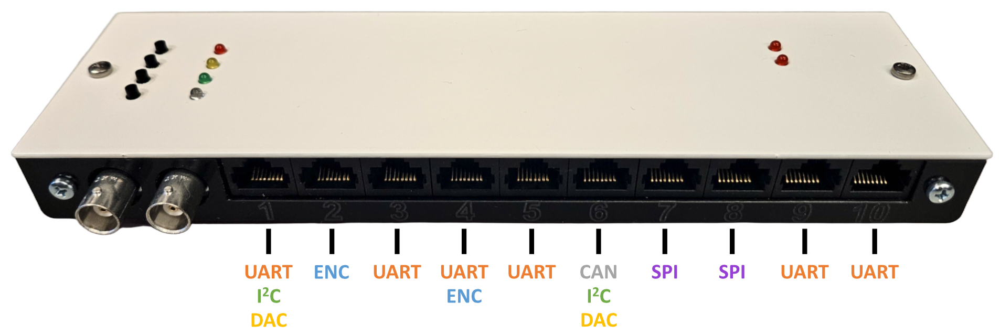
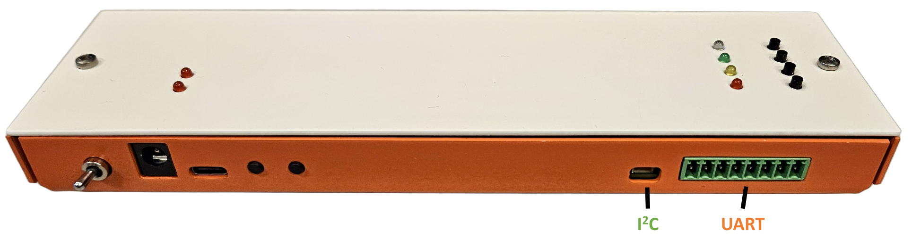
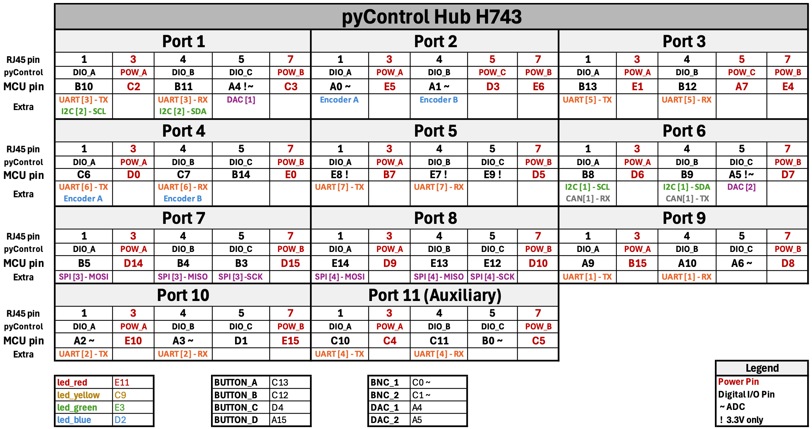

# Using

## Peripherals and Pin Mapping
Aside from basic GPIO and power pins, particular pyControl ports have additional peripherals.
See below for an overview of the peripherals on the front and back of the board as well as detailed table with all the pin mapping.

## Startup Modes

Press the top User button (Button A) and then press the Reset button. 
The LEDs will cycle through the following modes below. 
Release the user button to enter the mode.

| LED Color | Mode | What it does |
| --- | --- | --- |
| 🔴 Red | Factory reset | Reformats the `/flash` filesystem on the QSPI chip as FAT and adds fresh `boot.py`, `main.py`, `README.txt` and `pybcdc.inf`. **Everything on the flash is erased**, including the pyControl framework and task files.
| 🟡 Yellow | Safe mode | Skips `boot.py` and `main.py`. The filesystem still mounts and you get a REPL.  It only applies to that one boot; the next reset, even a soft reset (Ctrl-D), boots normally. |
| 🟢 Green | Normal | Runs `boot.py` then `main.py`, the same as a plain reset. |

## Loading MicroPython
- Put the board in the off position
- Connect the breakout to power and USB,
- Press and hold the DFU button and switch the board on. You can release the DFU button once the board is on.
- The DFU device will appear in the flasher 
- Select the device and click flash

[:material-file-download: Device file](using/hub_h743.py){ .md-button .md-button--primary }